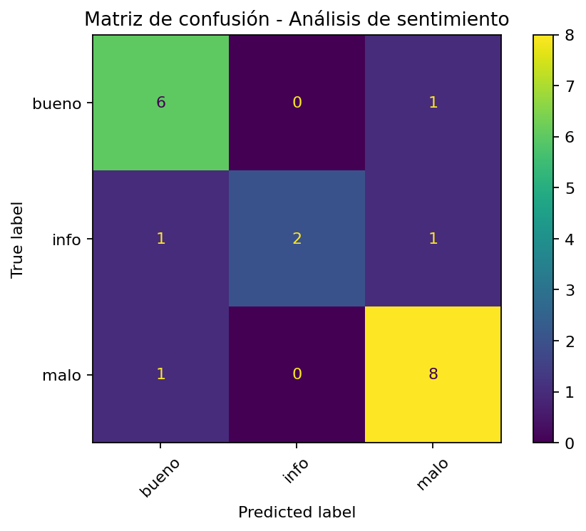

# Análisis de sentimiento con NLP y Machine Learning

Proyecto educativo de **Procesamiento de Lenguaje Natural (NLP)** para clasificar comentarios en tres categorías:

- `bueno`
- `malo`
- `info`

El objetivo es demostrar un flujo completo de NLP clásico en Python: limpieza de texto, representación numérica mediante **TF-IDF**, uso de **n-gramas**, entrenamiento de un modelo de **Regresión Logística** y evaluación con métricas de clasificación.

## Tecnologías utilizadas

- Python
- Pandas
- Expresiones regulares (`re`)
- Scikit-learn
- `TfidfVectorizer`
- Regresión Logística
- Matplotlib
- Joblib

## Flujo del proyecto

```text
Comentarios
    ↓
Limpieza y normalización
    ↓
Eliminación de duplicados
    ↓
Train / Test Split
    ↓
TF-IDF + unigramas y bigramas
    ↓
Regresión Logística
    ↓
Predicción: bueno / malo / info
    ↓
Accuracy + Precision + Recall + F1-score + Matriz de confusión
```

## ¿Por qué se eliminan comentarios duplicados?

El dataset original contiene comentarios repetidos. Si una misma frase aparece tanto en entrenamiento como en prueba, el modelo podría obtener métricas artificialmente altas porque ya habría visto prácticamente el mismo texto durante el entrenamiento.

Por eso el script elimina duplicados **antes** de dividir los datos en `train` y `test`.

## Estructura

```text
sentimiento-nlp/
├── data/
│   └── comentarios.csv
├── notebooks/
│   └── 01_analisis_sentimiento.ipynb
├── models/
│   └── .gitkeep
├── outputs/
│   └── .gitkeep
├── src/
│   ├── train_sentiment.py
│   └── predict.py
├── .gitignore
├── requirements.txt
└── README.md
```

## Instalación

Clona el repositorio y crea un entorno virtual:

```bash
git clone <URL-DE-TU-REPOSITORIO>
cd sentimiento-nlp
python -m venv .venv
```

Activa el entorno e instala las dependencias:

```bash
pip install -r requirements.txt
```

## Entrenar el modelo

```bash
python src/train_sentiment.py
```

El script:

1. carga `data/comentarios.csv`;
2. limpia y normaliza los comentarios;
3. elimina comentarios duplicados;
4. divide los datos en entrenamiento y prueba;
5. transforma el texto con TF-IDF usando unigramas y bigramas;
6. entrena una Regresión Logística;
7. calcula métricas de clasificación;
8. guarda el pipeline entrenado en `models/`;
9. genera la matriz de confusión en `outputs/`.


## Resultado del baseline

Con el `random_state=42` incluido en el proyecto, el modelo obtuvo aproximadamente:

| Métrica | Resultado |
|---|---:|
| Accuracy | 0.80 |
| F1 ponderado | 0.79 |
| Registros de test | 20 |

> Estos resultados corresponden a un dataset educativo pequeño después de eliminar duplicados. No deben interpretarse como rendimiento de producción.

La matriz de confusión generada se guarda en:

```text
outputs/confusion_matrix.png
```



## Realizar una predicción

Después de entrenar el modelo:

```bash
python src/predict.py "La atención fue excelente"
```

También puedes ejecutar:

```bash
python src/predict.py
```

y escribir el comentario cuando el programa lo solicite.

## Conceptos de NLP aplicados

### Limpieza y normalización

Se convierte el texto a minúsculas y se eliminan URLs, menciones, números, puntuación y espacios innecesarios.

### TF-IDF

Convierte los comentarios en vectores numéricos. Las palabras muy frecuentes en todos los documentos reciben menor peso, mientras que términos más representativos reciben mayor importancia.

### N-gramas

Se utilizan unigramas y bigramas mediante:

```python
ngram_range=(1, 2)
```

Esto permite representar tanto palabras individuales como combinaciones de dos palabras consecutivas.

### Regresión Logística

El modelo aprende la relación entre los vectores TF-IDF y las clases `bueno`, `malo` e `info`.

## Consideraciones

Este es un proyecto educativo y el dataset es relativamente pequeño después de eliminar duplicados. Por eso las métricas deben interpretarse con cautela. Una mejora futura sería ampliar el corpus con comentarios únicos y comparar varios modelos.

## Próximas mejoras

- Comparar Regresión Logística con Naive Bayes y SVM.
- Implementar validación cruzada.
- Analizar palabras y n-gramas más importantes por clase.
- Probar Word2Vec o FastText.
- Comparar el enfoque clásico con un Transformer en español, como BETO.
- Crear una API con FastAPI o una interfaz con Streamlit.

## Autor

**Héctor López**  
Proyecto de aprendizaje y portafolio en Data Science / NLP.
